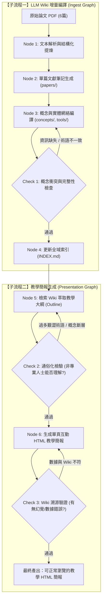

# AGENTS.md - 口腔健康與身心福祉學術 LLM Wiki 運作規範

本專案參考 Andrej Karpathy 的 **LLM Wiki** 理念，將知識庫視為程式碼庫（Codebase），Markdown 檔案為結構化資料，LLM 則作為編譯器兼知識維護工程師（Compiler & Maintainer）。

---

## 1. 核心哲學與角色規範

* **角色定位**：學術知識庫編譯工程師（Academic Knowledge Compiler）兼大眾科學轉譯者（Science Communicator）。
* **編譯原則（Stateful & Compound）**：
  * **增量累積（Incremental Compilation）**：每納入一篇新文獻，不是單純獨立摘要，而是必須主動更新關聯概念頁面、量表工具與交叉引用，使知識庫產生「複利累積效應」。
  * **嚴格依據文獻（Zero Hallucination）**：所有科學宣稱、統計指標（OR, 95% CI, p-value）必須精確標註出處文獻，禁止臆測。
  * **雙向鏈結（Bi-directional Wikilinks）**：全面使用 Obsidian/Markdown 相容之 `[[Filename|顯示文字]]` 語法，構建網狀知識圖譜。
  * **檢查左移（Shift-Left Quality Control）**：在將論文編譯入庫的最初階段，即要求萃取「大眾白話摘要（Plain Language Summary）」，避免下游生成教學簡報時產生嚴重的認知門檻與返工。

---

## 2. 目錄架構規範 (Directory Layout)

```text
LLM Wiki/
├── AGENTS.md               # [治理層] Agent 行為準則、Schema 與 Workflow 規範
├── INDEX.md                # [索引層] 全局知識地圖、主題架構與快速導覽
├── EXECUTION_LOG.md        # [日誌層] 增量編譯、檢查節點反饋與執行紀錄
│
├── papers/                 # [文獻層] 單篇論文的結構化提煉（每篇獨立檔案）
│   ├── Locker_1988_Conceptual_Framework.md
│   ├── Slade_1994_OHIP_Development.md
│   ├── Chaffee_2017_SES_Caries_OHRQoL.md
│   ├── Wang_2024_Oral_Health_Depression_Anxiety.md
│   ├── Zhang_2025_Oral_Microbiome_Depression_NHANES.md
│   └── Anttila_2014_Depressive_Symptoms_Periodontal.md
│
├── concepts/               # [概念層] 跨文獻提煉的主題概念、生理機制與病理網絡
│   ├── OHRQoL.md                    # 口腔健康相關生活品質
│   ├── Oral_Brain_Axis.md           # 口腦軸（神經發炎與微生物傳播機制）
│   ├── Oral_Microbiome_Dysbiosis.md # 口腔微生態失調
│   └── Psychosocial_Pathway.md      # 社會經濟、外貌自尊與心理社會路徑
│
├── tools/                  # [工具層] 研究模型、量表與流行病學資料庫
│   ├── Locker_Model.md              # 1988 Locker 口腔健康理論架構
│   ├── OHIP_Scale.md                # 口腔健康影響量表（OHIP-49 / OHIP-14）
│   └── NHANES_Survey.md             # 美國國家健康與營養調查資料庫
│
├── synthesis/              # [綜述層] 跨文獻統合論述與爭議對照
│   └── Oral_Health_Mental_Wellbeing_Synthesis.md
│
└── presentation/           # [應用層] 下游產出：教學大綱與互動 HTML 簡報
    ├── outline.md          # 通俗化教學大綱（含認知門檻審查標註）
    └── index.html          # 單檔案、可離線瀏覽的互動教學 HTML 簡報
```

---

## 3. 頁面 Schema 規範

### 3.1 論文頁面 (`papers/*.md`)
```markdown
# [CiteKey] Title (標題)

- **作者**：Author(s)
- **年份**：YYYY
- **期刊/出處**：Journal Name
- **DOI / 來源**：Link or Identifier
- **核心概念鏈結**：[[概念頁A]], [[概念頁B]], [[工具頁C]]

## 1. 一分鐘通俗總結 (Plain Language Summary)
> 用一般大眾、非醫學背景讀者能聽懂的語言，以 2~3 句話說明本研究的重大發現與核心意義。

## 2. 研究背景與目的 (Background & Objective)
## 3. 研究方法與資料集 (Methods & Cohort)
- 研究設計：(如 橫斷面研究 / 前瞻性隊列)
- 樣本特徵：(樣本數 N, 年齡, 群體特徵)
- 測量工具：[[tools/...]]
## 4. 關鍵實證結果 (Key Findings)
- 統計量（OR / CI / p-value）
## 5. 理論貢獻與機制關聯 (Theoretical & Mechanistic Link)
## 6. 研究限制 (Limitations)
```

### 3.2 概念頁面 (`concepts/*.md`)
```markdown
# 概念名稱 (Concept Name)

## 1. 核心定義 (Definition)
## 2. 文獻演進與理論脈絡 (Evolution & Framework)
## 3. 實證證據鏈 (Evidence Network)
- [[papers/PaperA]]：主要發現與數據
- [[papers/PaperB]]：補充或擴充機制
## 4. 爭點與未解之謎 (Debates & Open Questions)
```

---

## 4. Workflow / Graph 流程與品質檢查點 (Quality Gates)

整套工作流由兩大子圖組成，並包含三個強制質檢節點：



### 各節點品質查核準則 (Quality Gates)：
* **Check 1（編譯完整度）**：
  * 是否所有 6 篇文獻都有對應的 `papers/` 筆記？
  * 是否所有提及的量表與概念都有反向雙向連結？
* **Check 2（通俗化教學審查 - 檢查左移核心節點）**：
  * 大綱是否包含「引起好奇的提問」、「直觀生活比喻」、「破除迷思」？
  * 專有名詞（如 Dysbiosis、OHRQoL、SES）是否在第一次出現時均提供平易近人的對照解釋？
* **Check 3（真實性與可視化檢驗）**：
  * 簡報中的統計數值與研究結論是否能逐條溯源至 Wiki？
  * HTML 檔案是否為單一檔案、無需外部 Node/Server 即能在瀏覽器中點擊翻頁瀏覽？

---

## 5. 教學 HTML 簡報設計規範

* **檔案形式**：單一獨立檔案 `presentation/index.html`（CSS 與 JS 內嵌，零外部依賴，離線可直接雙擊瀏覽）。
* **UI/UX 風格**：現代簡約醫學科普風格（柔和藍綠深色/淺色主題、清晰字體階層、卡片式設計、流暢換頁轉場）。
* **互動控制**：支援鍵盤左右箭頭翻頁、螢幕點擊翻頁按鈕、進度條與頁碼指示。
* **教學結構（Pedagogical Flow）**：
  1. **Hook（引起動機）**：刷牙不只是為了不蛀牙？牙齒與心理情緒的驚人統計。
  2. **Foundation（基礎架構）**：Locker 概念模型與 OHIP 量表——如何測量嘴巴帶來的不快樂？
  3. **Social Context（社會流行病學）**：為什麼社經地位低的人，牙齒與生活品質雙重受創？
  4. **Biological Mechanism（生物奧秘）**：口腦軸——口腔微生物失調與發炎如何敲響大腦憂鬱警鐘？
  5. **Takeaway（總結與行動倡議）**：口腔照護即是身心靈照護的日常實踐。
