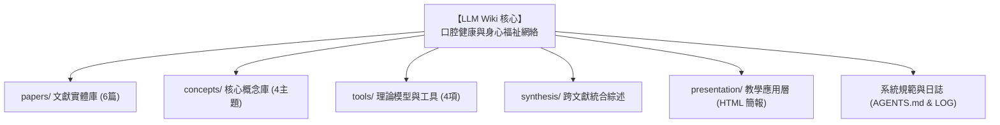

# 口腔健康與身心福祉學術 LLM Wiki (Oral-Brain Axis Knowledge Base)

歡迎來到 **「從牙齒到心靈：口腔健康、生活品質（OHRQoL）與身心健康的生物-心理-社會網絡」** 學術知識庫。

本 Wiki 遵循 Andrej Karpathy 的 **LLM Wiki** 架構打造，以 Markdown 檔案為程式碼庫、雙向鏈結（Wikilinks）為神經元網絡，經由 AI 增量編譯，收錄了口腔流行病學、心理計量學、社會醫學與微生物體學的核心文獻。

---

## 快速導覽目錄 (Quick Navigation)

---

## 1. 跨文獻統合綜述 (Synthesis)
* **核心旗艦頁面**：[[synthesis/Oral_Health_Mental_Wellbeing_Synthesis|口腔健康與身心福祉的生物-心理-社會網絡跨文獻綜述]]
  * 彙整 6 篇文獻的實證對照矩陣
  * 解構「牙齒差 vs 心情差」的雙向因果爭議
  * 剖析血液發炎 CRP 僅中介 3% 之後的未解之謎

---

## 2. 文獻實體層 (Papers - 6 篇已完整編譯)
1. [[papers/Locker_1988_Conceptual_Framework|Locker (1988)]] - *Measuring Oral Health: A Conceptual Framework*
   * **貢獻**：奠定 OHRQoL 的理論雛形，打破純臨床組織缺損思維。
2. [[papers/Slade_1994_OHIP_Development|Slade & Spencer (1994)]] - *Development and Evaluation of the Oral Health Impact Profile*
   * **貢獻**：將理論化為 49 題 OHIP 標準化評估量表，量化 7 大生活衝擊維度。
3. [[papers/Chaffee_2017_SES_Caries_OHRQoL|Chaffee et al. (2017)]] - *Oral Health-Related Quality-of-Life Scores Differ by SES and Caries*
   * **貢獻**：揭示低社經家庭在相同齲齒程度下回報衝擊低 30% 的「適應性偏誤」。
4. [[papers/ONeil_2014_Dental_Health_Depression_NHANES|O'Neil et al. (2014)]] - *The Association Between Poor Dental Health and Depression (NHANES)*
   * **貢獻**：萬人國家大數據證實口腔疾患與憂鬱呈顯著劑量效應（6項問題 OR = 3.94）。
5. [[papers/Wang_2024_Oral_Health_Depression_Anxiety_UKB|Wang et al. (2024)]] - *Associations Between Oral Health and Depression/Anxiety (UK Biobank)*
   * **貢獻**：26 萬人、長達 9 年的前瞻性追蹤，確證牙周病為新發憂鬱/焦慮的獨立前置風險。
6. [[papers/Zhang_2025_Oral_Microbiome_Depression_NHANES|Zhang et al. (2025)]] - *Association of Oral Microbiome Diversity With Depression (NHANES)*
   * **貢獻**：16S rRNA 微生物定序，證實口腔菌群 α 多樣性越匱乏，重度憂鬱風險越高。

---

## 3. 核心概念網絡 (Concepts)
* [[concepts/OHRQoL|口腔健康相關生活品質 (OHRQoL)]]：衡量口腔如何實質干擾日常生活與自尊。
* [[concepts/Oral_Brain_Axis|口腦軸 (The Oral-Brain Axis)]]：神經免疫、血腦屏障、神經傳導與發炎級聯反應。
* [[concepts/Oral_Microbiome_Dysbiosis|口腔微生態失調 (Dysbiosis)]]：細菌豐富度（ASV）下滑與致病菌優勢化。
* [[concepts/Psychosocial_Pathway|心理社會路徑 (Psychosocial Pathway)]]：外貌羞恥、社交迴避、孤立與家庭自責。

---

## 4. 研究工具與資料庫 (Tools & Datasets)
* [[tools/Locker_Model|Locker 概念架構模型]]：疾病 → 損傷 → 功能限制/疼痛 → 失能 → 障礙。
* [[tools/OHIP_Scale|OHIP 口腔健康影響量表]]：包含 OHIP-49、OHIP-14 與幼兒 ECOHIS。
* [[tools/NHANES_Survey|美國國家健康與營養調查 (NHANES)]]：具全美代表性的體檢、問卷與微生物體定序庫。
* [[tools/UK_Biobank|英國人體生物資料庫 (UK Biobank)]]：50 萬人規模並串聯真實世界 NHS 住院病歷之世代庫。

---

## 5. 治理與執行規範 (Governance)
* [[AGENTS.md]]：Agent 操作原則、資料 Schema、Loop/Graph 流程圖與品質檢查門（Quality Gates）。
* [[EXECUTION_LOG.md]]：增量編譯歷程、檢查左移（Shift-Left Check）紀錄與反思修正日誌。
* [[presentation/index.html|教學型互動 HTML 簡報]]：以本 Wiki 為單一真實來源所生成的科普互動簡報。
