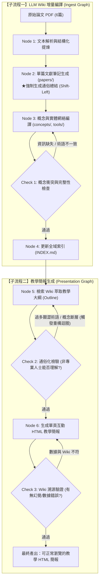

# 口腔健康與身心福祉學術 LLM Wiki (Oral-Brain Axis Knowledge Base)

本專案參考 Andrej Karpathy 的 **LLM Wiki** 核心架構（以 Codebase 形式管理結構化 Markdown、雙向鏈結與增量編譯），構建了關於「口腔健康、生活品質與心身健康網絡」的學術知識庫，並基於 Wiki 知識生成了互動教學 HTML 簡報。

---

## 📌 作業繳交成果快速導覽

1. **LLM Wiki 主題與簡介**：探討口腔疾病如何跨越純生理層面，透過神經發炎與心理社會途徑影響全人福祉。
2. **Wiki 核心文件**：
   - [INDEX.md](INDEX.md)：全局知識網絡地圖
   - [AGENTS.md](AGENTS.md)：LLM Agent 運作規範與 Workflow 協議
   - [synthesis/Oral_Health_Mental_Wellbeing_Synthesis.md](synthesis/Oral_Health_Mental_Wellbeing_Synthesis.md)：跨文獻統合綜述
   - [papers/](papers/)：收錄 6 篇精讀文獻結構化筆記（含通俗總結）
   - [concepts/](concepts/)：收錄 4 大核心生理與心理機制
   - [tools/](tools/)：收錄 4 項研究模型與國家級大數據庫
3. **教學 HTML 簡報**：
   - 簡報檔案：[presentation/index.html](presentation/index.html) *(單檔獨立、可離線或透過 GitHub Pages 直接瀏覽)*
   - 簡報大綱：[presentation/outline.md](presentation/outline.md)
4. **執行紀錄與反思報告**：
   - [EXECUTION_LOG.md](EXECUTION_LOG.md)：實際審查紀錄與「檢查左移（Shift-Left）」反思

---

## 🔄 Loop / Graph 流程架構

---

## 💡 核心反思 (Reflection)
* **最常出錯節點**：Node 6（HTML 簡報生成節點）。直接由學術文獻驅動時易堆砌生硬術語；若在最後修改 HTML 程式碼易導致版面破壞。
* **檢查左移（Shift-Left）**：
  1. 往前移至 **Node 2**：論文入庫時強制要求生成「一分鐘通俗總結」。
  2. 往前移至 **Node 5**：在大綱階段執行 Check 2 認知負擔審查，在純文字層面排除艱澀術語。
