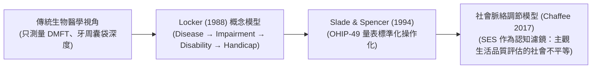

# 口腔健康相關生活品質 (Oral Health-Related Quality of Life, OHRQoL)

- **對應領域**：牙醫社會學 / 流行病學 / 心理計量學
- **關聯文獻**：[[papers/Locker_1988_Conceptual_Framework|Locker (1988)]], [[papers/Slade_1994_OHIP_Development|Slade & Spencer (1994)]], [[papers/Chaffee_2017_SES_Caries_OHRQoL|Chaffee et al. (2017)]]
- **關聯工具**：[[tools/OHIP_Scale|OHIP 量表]], [[tools/Locker_Model|Locker 模型]]

---

## 1. 核心定義 (Definition)
口腔健康相關生活品質（OHRQoL）是一個多維度的評估指標，用以衡量個人的口腔疾患、齒列狀態及組織損傷，在多大程度上**干擾了日常生活功能、個人主觀心理感受及社會角色適應**。

它跳脫傳統「牙醫拿探針數有幾顆蛀牙（客觀病理指標）」的限制，將病患本人的生活體驗置於核心。

---

## 2. 理論演進與概念脈絡

1. **奠基時期**：[[papers/Locker_1988_Conceptual_Framework|Locker (1988)]] 借鑒 WHO ICIDH 架構，正式將口腔問題劃分為功能限制、疼痛不適、失能與社會不利。
2. **工具化時期**：[[papers/Slade_1994_OHIP_Development|Slade & Spencer (1994)]] 將抽象構念轉化為 49 題的 OHIP 量表，使全球研究具備客觀橫向對比標尺。
3. **批判與社會深化**：[[papers/Chaffee_2017_SES_Caries_OHRQoL|Chaffee et al. (2017)]] 指出 OHRQoL 具有高度**情境依賴性（Context-dependent）**——相同疾病程度下，弱勢群體因適應常態與邊緣化生存壓力，反而回報較低衝擊。

---

## 3. OHRQoL 評估的 7 大核心維度 (基於 OHIP)
1. **咀嚼與發音限制**（Functional Limitation）
2. **牙齒與顏面疼痛**（Physical Pain）
3. **外貌焦慮與尷尬**（Psychological Discomfort）
4. **飲食中斷與食物忌口**（Physical Disability）
5. **睡眠受擾與情緒低落**（Psychological Disability）
6. **社交迴避與人際摩擦**（Social Disability）
7. **整體生活滿意度下降與職涯受阻**（Handicap）

---

## 4. 關鍵爭論與未解挑戰
* **主觀適應悖論（The Disability Paradox）**：為什麼長期嚴重缺牙的長者，有時自評的生活品質得分比只有一顆蛀牙的年輕白領還高？這反映了心理調適機制與期望值重塑對評估分數的巨大干擾。
