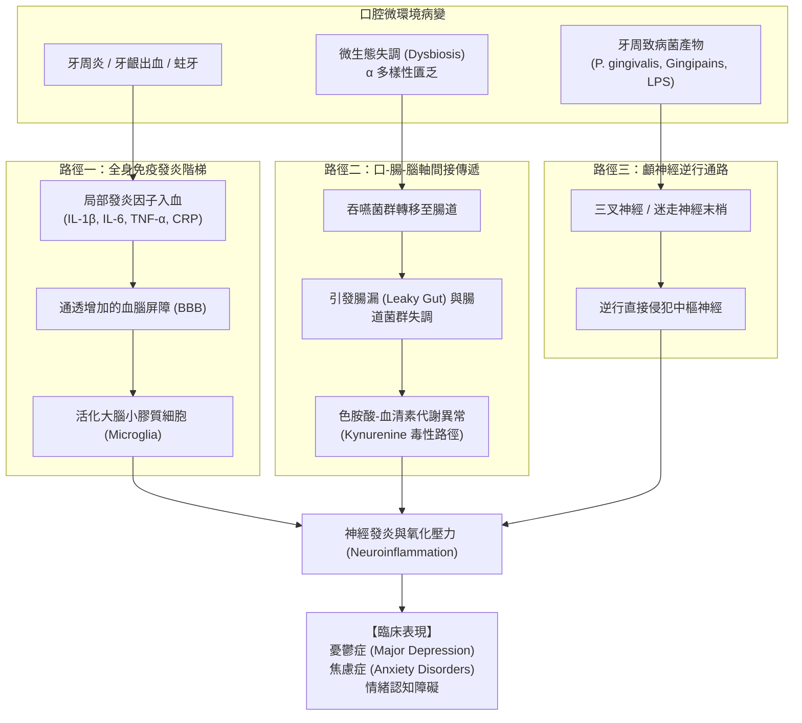

# 口腦軸 (The Oral-Brain Axis)

- **對應領域**：神經免疫學 / 生物精神醫學 / 口腔醫學
- **關聯文獻**：[[papers/ONeil_2014_Dental_Health_Depression_NHANES|O'Neil et al. (2014)]], [[papers/Wang_2024_Oral_Health_Depression_Anxiety_UKB|Wang et al. (2024)]], [[papers/Zhang_2025_Oral_Microbiome_Depression_NHANES|Zhang et al. (2025)]]
- **關聯概念**：[[concepts/Oral_Microbiome_Dysbiosis|口腔微生態失調]], [[concepts/Psychosocial_Pathway|心理社會路徑]]

---

## 1. 核心定義 (Definition)
**口腦軸（Oral-Brain Axis）** 指口腔微環境（包括牙周組織、口腔黏膜、唾液神經內分泌介質及多達 700 餘種微生物菌群）與中樞神經系統（CNS，特別是大腦情緒調節網絡如海馬迴、杏仁核與下視丘）之間的**雙向溝通生化網絡**。

---

## 2. 三大核心致病傳導路徑 (Biological Transmission Pathways)

1. **體循環與血腦屏障滲漏（Circulation & BBB Permeability）**：
   - 牙周炎造成牙齦微血管破裂，致病菌內毒素（LPS）與發炎細胞因子（IL-6, TNF-α, CRP）進入全身循環。
   - [[papers/Wang_2024_Oral_Health_Depression_Anxiety_UKB|Wang (2024)]] 透過中介分析指出，血液中的 CRP 與白血球計數直接解釋了約 3% 的牙周病促發憂鬱焦慮路徑。
2. **色胺酸-犬尿氨酸路徑（Tryptophan-Kynurenine Pathway）**：
   - 全身慢性發炎活化 IDO（吲哚胺2,3-雙加氧酶），將製造「快樂賀爾蒙」血清素的原料（色胺酸）轉向生成具有神經毒性與焦慮誘發效應的犬尿氨酸（Kynurenine），使大腦血清素水平暴跌。
3. **微生物組直接調控**：
   - [[papers/Zhang_2025_Oral_Microbiome_Depression_NHANES|Zhang (2025)]] 證實口腔菌群 α 多樣性顯著低下與重度憂鬱風險成高度線性反比（OR = 0.992），揭示了菌群結構失衡可能是神經發炎的最上游觸發點。

---

## 3. 雙向性與惡性循環 (The Vicious Cycle)
口腦軸並非單向車道，而是互相牽引的惡性閉環：
* **下行衝擊（大腦 → 口腔）**：憂鬱焦慮引發長期皮質醇（Cortisol）分泌紊亂、自律神經失調、唾液流量銳減（口乾症），加上患者動力缺乏、忽略刷牙潔牙，使口腔菌斑與牙周破壞急遽加劇。
* **上行衝擊（口腔 → 大腦）**：口腔長期慢性化膿出血、疼痛與微生態失調，源源不絕向大腦輸送發炎訊號與心理自卑壓力，鎖死憂鬱狀態。
