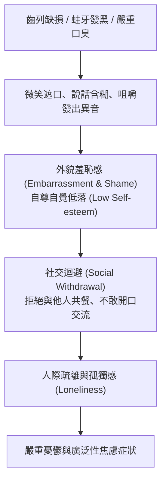

# 心理社會路徑 (The Psychosocial Pathway)

- **對應領域**：健康社會學 / 行為醫學 / 臨床心理學
- **關聯文獻**：[[papers/Locker_1988_Conceptual_Framework|Locker (1988)]], [[papers/Chaffee_2017_SES_Caries_OHRQoL|Chaffee et al. (2017)]], [[papers/ONeil_2014_Dental_Health_Depression_NHANES|O'Neil et al. (2014)]]
- **關聯概念**：[[concepts/OHRQoL|口腔健康相關生活品質]], [[concepts/Oral_Brain_Axis|口腦軸]]

---

## 1. 核心定義 (Definition)
**心理社會路徑（Psychosocial Pathway）** 描述了口腔外觀受損、疼痛與功能缺失，如何藉由**自我形象打擊、自尊崩跌、污名化（Stigma）、社交退縮與家庭角色失能**，最終誘發或加劇憂鬱與焦慮情緒的心理與社會互動機制。

這條路徑與純生化發炎路徑相輔相成，共同構成了「口腦軸」的生物-心理-社會全貌。

---

## 2. 心理社會連鎖效應 (The Cascading Mechanism)

* **羞恥與社交畏懼**：在 [[papers/ONeil_2014_Dental_Health_Depression_NHANES|O'Neil et al. (2014)]] 的 NHANES 調查中，超過 **41.6%** 的憂鬱症患者明確回報「因嘴巴問題感到尷尬難堪（Embarrassed because of mouth）」。
* **家庭焦慮與內疚**：在 [[papers/Chaffee_2017_SES_Caries_OHRQoL|Chaffee et al. (2017)]] 幼兒研究中，家長最常回報的心理衝擊不是醫療費，而是對孩子的「內疚感（Felt guilty）」。
* **就業與親密關係劣勢**：[[papers/Locker_1988_Conceptual_Framework|Locker (1988)]] 指出，前牙缺損與顏面不對稱顯著降低面試錄取率、求偶成功率與學校融入感，將生理損傷直接轉換為社會階層與經濟上的實質不利（Handicap）。

---

## 3. 社會經濟地位 (SES) 的調節作用
* **雙重受創**：低 SES 族群蛀牙率與缺牙率最高，承受最沉重的生理痛苦。
* **感知鈍化（Under-reporting）**：如 Chaffee (2017) 所示，在生存與經濟高度壓迫下，弱勢家庭往往將牙齒問題「正常化（Normalized）」，缺乏求醫預算，形成習得性無助與被動耐受。
