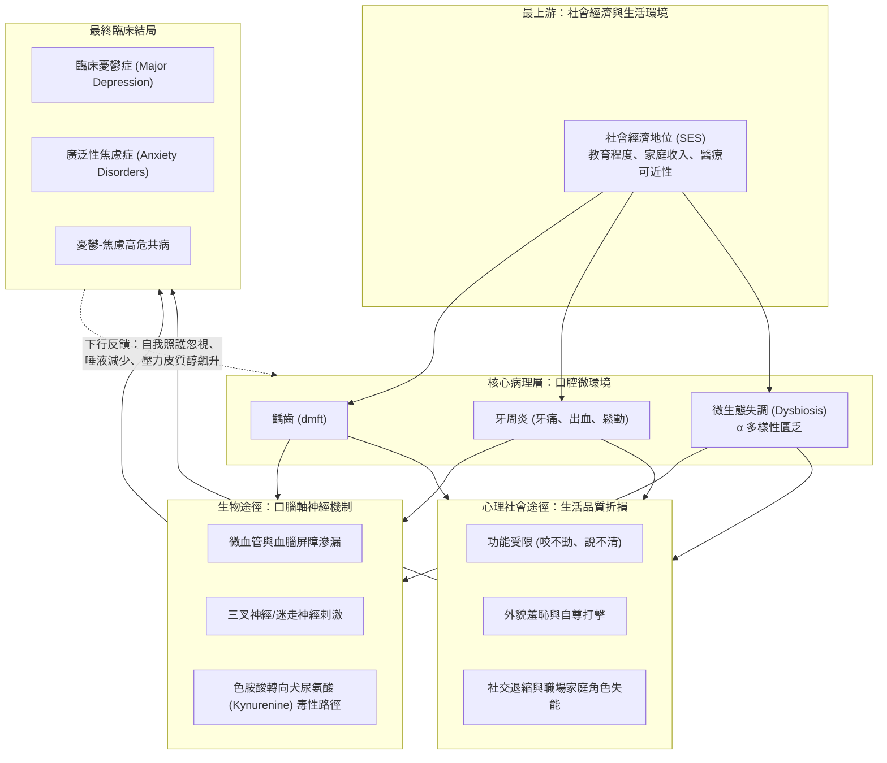

# 跨文獻統合綜述：口腔健康與身心福祉的生物-心理-社會網絡

- **維護狀態**：增量編譯完成（整合 6 篇經典與前沿論文）
- **關聯文獻**：[[papers/Locker_1988_Conceptual_Framework|Locker (1988)]], [[papers/Slade_1994_OHIP_Development|Slade & Spencer (1994)]], [[papers/Chaffee_2017_SES_Caries_OHRQoL|Chaffee (2017)]], [[papers/ONeil_2014_Dental_Health_Depression_NHANES|O'Neil (2014)]], [[papers/Wang_2024_Oral_Health_Depression_Anxiety_UKB|Wang (2024)]], [[papers/Zhang_2025_Oral_Microbiome_Depression_NHANES|Zhang (2025)]]

---

## 1. 綜述引言 (Executive Summary)
傳統牙科學曾長期被局限在「補牙、拔牙、洗牙」的組織修復視角。然而，近 40 年來的醫學跨領域研究證實：**口腔並非獨立於人體的孤島，而是全人身心健康的門戶與前哨站**。

本 Wiki 將 6 篇橫跨理論奠基、心理計量、社會流行病學到微生物基因體學的代表性文獻進行增量編譯，描繪出一個涵蓋**「生物（Microbiome & Inflammation）- 心理（Self-esteem & Coping）- 社會（SES & Role Functioning）」**的宏觀動態網絡。

---

## 2. 文獻證據對照矩陣 (Cross-Paper Evidence Matrix)

| 論文代碼 | 樣本量與族群 | 研究設計 | 核心測量工具 | 關鍵發現 | 對 Wiki 架構的獨特貢獻 |
| :--- | :---: | :---: | :--- | :--- | :--- |
| **[[papers/Locker_1988_Conceptual_Framework\|Locker (1988)]]** | 理論回顧 | 理論模型提出 | WHO ICIDH 分類概念 | 疾病到障礙的 5 層動態傳導；指出傳統指標忽視社會後果 | **【理論基石】** 確立 OHRQoL 的骨幹架構 |
| **[[papers/Slade_1994_OHIP_Development\|Slade (1994)]]** | N=122 長者世代 + 328 評審 | 心理計量量表研製 | OHIP-49 量表 (7 大維度) | 高信度(α 0.70-0.83)與建構效度；量化口腔疾病造成的個人與社交衝擊 | **【測量工具】** 使主觀生活品質評估得以標準化操作 |
| **[[papers/Chaffee_2017_SES_Caries_OHRQoL\|Chaffee (2017)]]** | N=456 巴西幼兒及母 | 橫斷面 (巢狀世代) | 臨床 dmft + 巴西版 B-ECOHIS | 齲齒越多 OHRQoL 越差(3倍)；但低 SES 母親回報衝擊顯著較低(少30%) | **【社會調節】** 揭示主觀評估的「適應性偏誤」與醫療平權盲點 |
| **[[papers/ONeil_2014_Dental_Health_Depression_NHANES\|O'Neil (2014)]]** | N=10,214 美國成人 | 國家代表性橫斷面 | OHQ 問卷 + PHQ-9 (≥10分) | 口腔問題與憂鬱呈劑量反應(2項OR=1.6, 6項OR=3.94)；且獨立於 CRP 與 BMI | **【流行病學】** 證實口腔多重病變與臨床憂鬱症強烈關聯 |
| **[[papers/Wang_2024_Oral_Health_Depression_Anxiety_UKB\|Wang (2024)]]** | N=264,706 英國成人 | 9.03年 前瞻性追蹤世代 | UK Biobank + NHS 住院 ICD-10 診斷 | 牙周病預測新發憂鬱(HR 1.19)、焦慮(HR 1.13)與共病(HR 1.27)；CRP/WBC 僅中介 ~3% | **【因果縱向】** 確立時間序列先後；證實發炎僅能解釋極小部分途徑 |
| **[[papers/Zhang_2025_Oral_Microbiome_Depression_NHANES\|Zhang (2025)]]** | N=1,497 美國成人 | 微生物體流行病學 | 16S rRNA V4 定序 (ASV) + PHQ-9 | 口腔菌群 α 多樣性越低，重度憂鬱風險越高(OR=0.992)；β 多樣性結構顯著相異 | **【微觀機制】** 揭開「口-腦軸」微生物組生物標記與潛在神經調控 |

---

## 3. 核心理論爭點與科學對話 (Scientific Debates)

### 爭點一：牙齒差與心情差，到底誰是因？誰是果？
* **過去觀點**：精神醫學界長期認為是「憂鬱症導致口腔崩壞」——抑鬱患者生活自理崩解、缺乏動力刷牙，加上抗憂鬱藥物引發口乾（Xerostomia）。
* **Wiki 統合結論**：[[papers/Wang_2024_Oral_Health_Depression_Anxiety_UKB|Wang (2024)]] 的 9 年前瞻追蹤證明，在排除基線已患病個體後，**口腔疾病本身即是引發未來新發憂鬱症的獨立風險因子（HR 1.19）**。這確立了口腦軸本質上是個「雙向正反饋的惡性循環（Bi-directional Loop）」。

### 爭點二：發炎反應能解釋所有問題嗎？
* **過去假說**：牙周病引發的全身性慢性低度發炎（以 CRP 與發炎細胞因子為代表），會穿透腦血管引發神經發炎與憂鬱。
* **Wiki 突破發現**：
  * [[papers/ONeil_2014_Dental_Health_Depression_NHANES|O'Neil (2014)]] 發現控制 CRP 與 BMI 後，勝算比幾乎沒有降低。
  * [[papers/Wang_2024_Oral_Health_Depression_Anxiety_UKB|Wang (2024)]] 精確計算出 CRP 與 WBC 的中介比例僅有 **3%** 左右。
  * **結論**：全身血液發炎指標並非主幹道！真正的關鍵可能深藏於：
    1. [[papers/Zhang_2025_Oral_Microbiome_Depression_NHANES|Zhang (2025)]] 揭露的**口腔微生物群失調（Dysbiosis）**直接侵犯或刺激三叉神經/迷走神經。
    2. [[papers/Locker_1988_Conceptual_Framework|Locker (1988)]] 與 [[papers/Chaffee_2017_SES_Caries_OHRQoL|Chaffee (2017)]] 探討的**自尊羞愧、社交隔離與生活角色剝奪**等心理社會路徑。

---

## 4. 全局生物-心理-社會整合架構 (Unified Framework)

