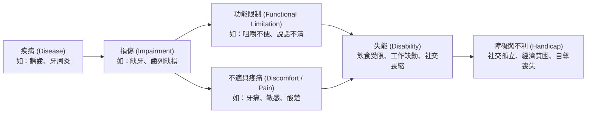

# Locker 概念架構模型 (Locker's Conceptual Framework of Oral Health)

- **提出者**：David Locker (1988)
- **提出文獻**：[[papers/Locker_1988_Conceptual_Framework|Community Dental Health, 5(1), 3-18]]
- **延伸工具**：[[tools/OHIP_Scale|OHIP 口腔健康影響量表]]
- **核心概念**：[[concepts/OHRQoL|口腔健康相關生活品質]], [[concepts/Psychosocial_Pathway|心理社會路徑]]

---

## 1. 模型結構圖 (Structural Diagram)

---

## 2. 理論核心特點
1. **借鑒 WHO ICIDH 分類法**：將原本針對一般慢性病的分類（疾病、損傷、失能、障礙）成功本土化至口腔醫學領域。
2. **多向度非必然性**：
   * 損傷（掉了牙）**不一定**必然轉變為失能或障礙；如果病患透過義齒修復、心理調適或擁有強大的家庭支持，其日常生活與心理福祉可能完全不受影響。
   * 相反地，即使客觀損傷很小（例如門牙微小缺角），若個體極度重視外觀或從事演藝/客服職業，可能直接演化為嚴重的心理失能與障礙。
3. **歷史地位**：終結了牙醫界數十年來「只看牙齒組織，不看全人福祉」的局限性，為現代健康生活品質研究立下不可動搖的里程碑。
